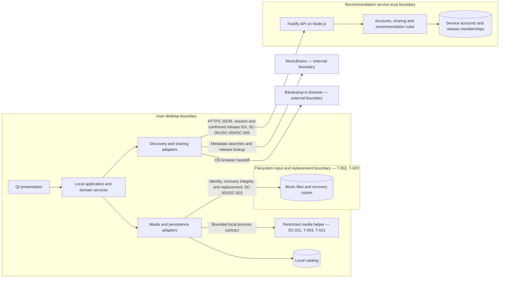

# Tag Zeppelin Architecture

[REQUIREMENTS.md](REQUIREMENTS.md) owns product behavior, scope, acceptance platforms, and performance; [DESIGN.md](DESIGN.md) owns presentation; [SECURITY.md](SECURITY.md) owns all controls. These are adopted implementation decisions.

## Technology and resolved decisions

| ID | Adopted decision and rationale |
| --- | --- |
| OD-001 | Node.js 24 LTS is the server runtime and Fastify 5 the API framework. The candidate Node.js 26 composition is rejected. |
| OD-002 | Qt 6.8 Widgets with C++17; use Core, Gui, Widgets, Network, Sql, and Test. The Qt 6.11 / C++23 pack is rejected. Native widgets suit collection tables, forms, keyboard navigation, and review. |
| OD-003 | JavaScript ES2022 modules without TypeScript or transpilation; ES2026 and TypeScript 7 packs do not apply. |
| OD-004 | No OPA/Rego or policy gateway. Authorization enforcement is owned by SC-006 in SECURITY.md. |
| OD-005 | One API process on an Ubuntu 24.04 LTS x64 host under systemd, without containers; the Dockerfile pack does not apply. Fastify terminates TLS. Host controls are owned by SC-007 in SECURITY.md. |
| OD-007 | TagLib 2.x behind the media adapter and separate SQLite 3.x local/service stores. This avoids an additional database service for the bounded pilot. A replacement database requires measured workload evidence against NFR-3.1; release controls are owned by SC-003 and SC-007 in SECURITY.md. |

Use CMake 3.28 or newer with MSVC 2022 on Windows, Xcode 16 on macOS, and GCC 13 on Ubuntu. Deliver native installers/packages with dependency/license notices. Version pinning and artifact controls are in SC-007 in [SECURITY.md](SECURITY.md).

Technology references: [Qt platform matrix](https://doc.qt.io/qt-6.8/supported-platforms.html), [Node.js release policy](https://github.com/nodejs/Release), [Fastify support policy](https://fastify.dev/docs/v5.7.x/Reference/LTS/), and [TagLib format documentation](https://taglib.org/). These inform selection, not application compatibility or preservation evidence.

## Components and ownership

These are logical modules. The restricted local media helper is a child process of the desktop application, not a network service or separately operated deployment. Isolation traces to [T-003](THREAT_MODEL.md#t-003), [T-005](THREAT_MODEL.md#t-005), and [T-021](THREAT_MODEL.md#t-021).

| Component | Implementation responsibility | Owned state | Product trace |
| --- | --- | --- | --- |
| Desktop presentation | Native views through application-service view/result contracts; presentation follows DESIGN.md | Transient view/focus state | FR-1.4–FR-1.6, FR-1.23–FR-1.24, FR-2.1–FR-2.7, FR-3.4–FR-3.7, FR-4.5, NFR-1.1–NFR-1.5 |
| Local application/domain services | Import, catalog queries, proposals, review, recovery coordination | Catalog, proposals, approvals, operation state, recovery references | FR-1.8–FR-1.12, FR-1.14, FR-1.18–FR-1.25, FR-1.29–FR-1.43, FR-2.1–FR-2.9, FR-4.1, NFR-2.1 |
| Persistence/media adapters | Format mapping and filesystem/catalog ports | Music files are authoritative for saved tags, audio, format, and duration; recovery copies hold prior contents | FR-1.1–FR-1.2, FR-1.7, FR-1.19, FR-1.22, FR-1.26–FR-1.43, FR-2.8–FR-2.9 |
| Desktop discovery/sharing adapters | MusicBrainz candidate, release/recording, artist discovery, and recommendation-label lookup; OS URL opening and service API calls | Transient lookup/results and sharing preview | FR-1.3, FR-1.13–FR-1.18, FR-3.1–FR-3.17, FR-4.4–FR-4.7 |
| Service account/sharing domain | Account and library operations | Accounts, roles/status, sessions, sharing state, distinct (account, release identifier) memberships | FR-4.2–FR-4.27 |
| Recommendation calculation | On-demand calculation through owner-defined read interfaces | Derived results | FR-3.2–FR-3.4, FR-3.7–FR-3.16, FR-4.3, FR-4.9–FR-4.10, FR-4.13 |

Local application/domain services run in the desktop process. Media parsing and staged metadata transformation run in a restricted local helper process controlled through the media adapter; the helper receives only the selected input/staged file and operation data, not service credentials or catalog-wide access. The local domain retains authority for approval, recovery and final replacement. Enforce SC-011 process work/memory limits and terminate failed work without mutating the original; this is an adopted isolation decision for [T-003](THREAT_MODEL.md#t-003), [T-005](THREAT_MODEL.md#t-005), and [T-021](THREAT_MODEL.md#t-021). Perform file and network work outside the UI thread. No local HTTP server, additional service, or background synchronization is required. Presentation constraints are defined in [DESIGN.md](DESIGN.md).

## Interfaces and persistence

The desktop-to-service interface uses HTTPS JSON request/response operations for registration, sign-in/out, library replacement/withdrawal, recommendations, deletion, and Admin suspension/restoration. Session and payload controls are defined in SC-001, SC-004, and SC-005 in [SECURITY.md](SECURITY.md).

A local SQLite catalog holds collection indexing, review state, and recovery-copy references. Store pending proposals separately from approvals and saved values. Recovery storage is application-managed and records the original-path association. Filesystem and catalog updates are separate operations; their reconciliation controls are defined in SC-003 in [SECURITY.md](SECURITY.md). TagLib maps stored fields through a format adapter; product fields and format scope are defined in [REQUIREMENTS.md](REQUIREMENTS.md).

The service SQLite database resides on local disk. Recommendation calculation uses cursor pages of ranked identifiers without contributor counts (FR-3.20–FR-3.23; [T-004](THREAT_MODEL.md#t-004), [T-008](THREAT_MODEL.md#t-008), [T-010](THREAT_MODEL.md#t-010)); the desktop completes pagination, applies its local collection comparison, and resolves labels via MusicBrainz. Page bounds and revision controls are defined in SC-001 and SC-004 in [SECURITY.md](SECURITY.md); observable calculation rules are FR-3.11–FR-3.16 in [REQUIREMENTS.md](REQUIREMENTS.md).

## Data flow and trust boundaries

- Import/query: presentation → local services → media adapter/catalog → view results.
- Review/save/restore: presentation → local domain → filesystem adapter and catalog → view results; sequencing controls are defined in SC-003 in [SECURITY.md](SECURITY.md).
- Discovery: catalog → desktop integration adapter → MusicBrainz → local discovery domain → presentation/OS browser handoff.
- Sharing/recommendations: desktop adapter → API → service domain → service store → desktop result processing.

The desktop filesystem, external network services, and recommendation API form distinct trust boundaries. Enforcement is defined in SC-001–SC-006 in [SECURITY.md](SECURITY.md).

Arrows show calls/access direction; responses return to the caller. The filesystem boundary is explicit even though access originates inside the desktop process; untrusted file contents do not gain trust by residing on local disk. Diagram hardening traces to [T-002](THREAT_MODEL.md#t-002), [T-003](THREAT_MODEL.md#t-003), [T-016](THREAT_MODEL.md#t-016), and [T-020](THREAT_MODEL.md#t-020).

The existing local services coordinate recovery integrity through the media/persistence ports (SC-003; FR-1.44). The existing service domain enforces requester/revision cursor binding (SC-004); desktop result processing discards invalidated page accumulations (FR-3.19). Disclosure context belongs to desktop presentation (FR-3.18; DESIGN.md). These placements introduce no additional deployment or background synchronization. Threats: [T-011](THREAT_MODEL.md#t-011), [T-015](THREAT_MODEL.md#t-015), [T-020](THREAT_MODEL.md#t-020), [T-023](THREAT_MODEL.md#t-023).

Implementation evidence must document race-resistant file identity/replacement and cross-process coordination, cursor binding, and deletion-cleanup recovery across process interruption. These are unresolved implementation evidence tasks under existing SC-003/SC-004/SC-008, not permission to weaken their guarantees or silently choose product policy. The resolved product/security choices are indexed by RQ-001–RQ-005 in REQUIREMENTS.md and OD-010–OD-019 in SECURITY.md; their required implementation and release evidence is still pending. Threats: [T-002](THREAT_MODEL.md#t-002), [T-006](THREAT_MODEL.md#t-006), [T-019](THREAT_MODEL.md#t-019), [T-022](THREAT_MODEL.md#t-022), [T-023](THREAT_MODEL.md#t-023).

## Dependency rules

- **DR-1:** Presentation depends on application services and their view/result contracts, not filesystem or storage adapters. Authorization controls are defined in SC-006 in [SECURITY.md](SECURITY.md).
- **DR-2:** Application services depend on domain rules and abstract ports for files, persistence, networking, and credentials. Domain rules do not depend on Qt, Fastify, Node.js APIs, SQLite, TagLib, or external response schemas. Adapters implement those ports; composition supplies them.
- **DR-3:** Local catalog and file access pass through their owning local services. Write-sequence enforcement is defined in SC-003 in [SECURITY.md](SECURITY.md).
- **DR-4:** Desktop-to-service traffic crosses the explicit API only. The server owns account/session/shared-library data; the desktop owns local media/catalog/recovery data. Neither reads the other's store directly, and there is no server-to-filesystem callback.
- **DR-5:** API handlers delegate to service domain operations. Recommendation calculation reads account eligibility and memberships through owner-defined read interfaces; it cannot modify accounts or libraries. Account/sharing operations do not depend on recommendation calculation.
- **DR-6:** Vendor adapters translate data/errors into domain contracts. Discovery rules consume those contracts rather than MusicBrainz or Bandcamp-specific objects. Shared-payload enforcement is defined in SC-004 in [SECURITY.md](SECURITY.md).
- **DR-7:** Commands travel inward from presentation/API to application/domain logic, then through ports to adapters; results travel back to the caller. No circular module dependencies or reciprocal service calls are permitted.

## Threat-driven implementation decisions

- The service account domain owns invitation validation, atomic consumption with account creation, canonical username identity, and admission before password hashing. Extend the existing local operator provisioning interface to issue invitations; no new remote Admin function is introduced. Invitation lifecycle controls are owned by SC-010, and product behavior by FR-4.29–FR-4.34. Threats: [T-001](THREAT_MODEL.md#t-001), [T-009](THREAT_MODEL.md#t-009), [T-017](THREAT_MODEL.md#t-017).
- The recommendation domain applies privacy eligibility before exact ranking and emits identifier-only pages; the desktop retains local filtering after complete pagination. Numeric policy belongs to FR-3.20–FR-3.23 and SC-009. Threats: [T-004](THREAT_MODEL.md#t-004), [T-008](THREAT_MODEL.md#t-008), [T-010](THREAT_MODEL.md#t-010).
- Admission counters and bounded queues are process/service-owned enforcement mechanisms before expensive work; SC-010–SC-011 own budgets. Rate-counter persistence, minimization and expiry controls are owned by SC-010. Threats: [T-005](THREAT_MODEL.md#t-005), [T-009](THREAT_MODEL.md#t-009), [T-017](THREAT_MODEL.md#t-017).
- Deployment remains the one-host topology already adopted. The prospective pilot host must be located in Germany. SC-015 requires actual deployment and release-context evidence before collection; this is an adopted location requirement, not an assertion of an existing deployment. Store-loss reprovisioning uses the existing operator provisioning path and preserves SC-008's no-backup policy. Threats: [T-010](THREAT_MODEL.md#t-010), [T-012](THREAT_MODEL.md#t-012), [T-025](THREAT_MODEL.md#t-025).
