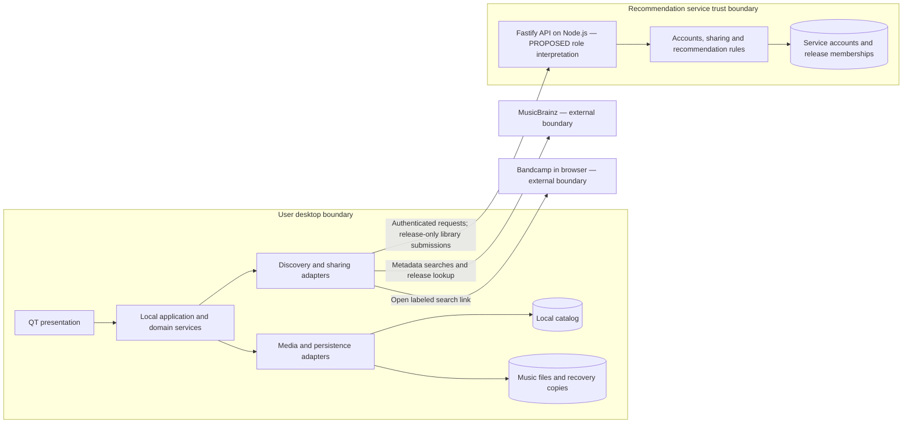

# Tag Zeppelin Architecture

This document owns how the system is built. [REQUIREMENTS.md](REQUIREMENTS.md) owns behavior; [DESIGN.md](DESIGN.md) owns visual and interaction constraints. Assume no implementation exists. `PROPOSED` marks recommendations, not confirmed technology selections. `SUPPORTED` means grounded in requirements, not implemented or tested.

## Required Architecture Inputs

| Field | Input |
| --- | --- |
| Requirements source | `REQUIREMENTS.md` |
| Design source | `DESIGN.md` |
| Target surfaces | Desktop: Windows 11 24H2 on x64, macOS 15 on Apple silicon, Ubuntu 24.04 LTS on x64. No other UI platforms (NFR-1.1–NFR-1.4). |
| Runtime and deployment environment | Developer input states server runtime: **Fastify**. Server hosting environment: `UNKNOWN`. Desktop environments are listed above. See terminology decision below. |
| Server framework | Developer input states **Node.js**. Version: `UNKNOWN`; Fastify version: `UNKNOWN`. |
| Client framework(s) | **QT**, as supplied. Version: `UNKNOWN`. |
| API style and integration model | `PROPOSED`: HTTPS JSON request/response API for accounts, explicit shared-library replacement, and recommendations; desktop adapters call MusicBrainz and open Bandcamp search links. |
| Authentication and session model | Local functions require no account; recommendation submissions and requests require sign-in. `PROPOSED`: service-managed credentials and revocable opaque sessions; server enforces ownership and Admin privileges. |
| Data model and scale expectations | Local files, stored metadata, collection entries, proposed/approved changes, and recovery copies; service accounts and shared release-identifier sets. Scale targets: `UNKNOWN`. `PROPOSED`: separate local and service SQLite stores. |
| Security expectations | Preserve FR-4.1–FR-4.15 and file-write safeguards FR-1.27–FR-1.32 at the boundaries below. Detailed controls and version-specific security packs are deferred to `SECURITY.md`; no unspecified version is confirmed here. |

## Architecture and Decisions

### Technology interpretation and scope

**Input conflict:** the supplied labels call Node.js the server framework and Fastify the server runtime. Those roles are reversed in conventional terminology. Preserve the supplied choices; `PROPOSED` interpretation: run a Fastify HTTP application on Node.js. This explicitly resolves the architectural interpretation without treating corrected labels or versions as developer-confirmed facts.

`PROPOSED`: use a native QT desktop application with C++ and Qt Widgets, plus one recommendation-service application. Widgets suit the desktop collection tables, forms, keyboard navigation, and explicit review workflow without introducing a browser frontend. Apply DESIGN.md tokens, accessible names, focus states, image fitting, and responsive review layout through the presentation layer. Validate the 1024 by 640 logical-pixel content area at default and 200% text sizes. Admin account controls occupy a separate role-specific area in the same client.

Local application services run in the desktop process and remain usable without network access or an account (FR-4.1, NFR-2.1). `PROPOSED`: perform file and network work outside the UI thread and serialize writes to each file. The remote service handles only accounts, submitted release identifiers, and recommendation calculations. No local HTTP server, additional service, or background synchronization is required.

### APIs and integrations

`PROPOSED`: use explicit request/response operations for registration, sign-in/out, shared-library replacement and withdrawal, recommendations, account deletion, and Admin suspension/restoration. The authenticated session determines the owner; client-supplied identity does not authorize access. A replacement request carries only the confirmed set of MusicBrainz release identifiers. Withdrawal and account deletion return success only after their required deletion commits.

MusicBrainz access belongs to the desktop integration adapter. It supports candidate searches, selected release/recording lookup, collection-artist release discovery, and resolving recommendation identifiers to display labels. Keep missing matched fields unchanged. `PROPOSED`: resolve collection artists to MusicBrainz artist identities when release discovery needs them; use explicit selection for ambiguous results, consistent with the existing match-selection interaction. Do not infer that a single candidate is selected for tagging (FR-1.14).

Purchase suggestions compare discovered release identifiers against the local collection and generate Bandcamp search links from artist and release title. Opening a link hands off to the user's browser; there is no Bandcamp API, availability check, or checkout. Network adapters distinguish no results from failures and expose retry actions. MusicBrainz receives search terms needed for lookup; the release-only sharing restriction applies to the recommendation service, not the required metadata searches.

### Persistence and file integrity

`PROPOSED`: a local SQLite catalog owns collection indexing, review state, and recovery-copy references. Music files remain authoritative for saved tags, audio, format, and duration. Catalog entries are unique by absolute path; do not invent content-based deduplication. Refresh and successful saves reconcile the catalog from file contents. Removing an entry never removes its music file.

Store pending proposals separately from approved changes and saved values. `PROPOSED`: persist approved changes for retry across application restarts. Validate positive integers, permitted date forms, and readable JPEG/PNG images in the local domain layer. A file adapter maps stored fields to each supported format; it must preserve audio and all unapproved metadata.

`PROPOSED`: use TagLib behind that adapter, subject to a compatibility gate for FLAC, MP3, AAC in M4A, Ogg Vorbis, Ogg Opus, and AIFF. Its version is `UNKNOWN`. The gate must demonstrate all required fields, front art, MusicBrainz identifiers, and preservation behavior before adoption; the library choice does not relax any requirement.

Before each write, create a complete recovery copy in application-managed local storage and record its association with the original path. `PROPOSED`: stage the updated file locally, verify preservation, and replace the original at its existing path only after the recovery copy succeeds. Detect changes since review and require renewed review rather than overwriting changed source values. Retain recovery copies until explicit deletion. Restoration requires confirmation of the selected copy; refresh the catalog afterward. Filesystem and catalog updates are not one transaction: retain operation state so an interrupted save can be reconciled from the actual file without claiming false success.

`PROPOSED`: use a separate SQLite service database for accounts, role/access status, sessions, sharing state, and distinct `(account, release identifier)` memberships. This avoids an additional database service while scale is unspecified. Replace a library and withdraw/delete data transactionally. Recommendations are calculated on demand; do not persist a second copy of shared libraries in a recommendation cache. A different database needs evidence from measured workload, not an invented scale target.

### Authentication, privacy, and recommendation rules

`PROPOSED`: use a username and password for registration/sign-in, service-side credential verification, and opaque revocable sessions. Store the client session secret through the operating system's credential facility. Signing out revokes the session. Suspension denies service access, revokes sessions, and excludes the account from calculations; restoring access requires a fresh sign-in. Initial Admin assignment is an operator-controlled service configuration action, never self-registration. Detailed credential, transport, and session controls belong in `SECURITY.md`.

Sharing starts disabled. Preview and confirmation produce an immutable release-identifier set for a single explicit submission. No automatic upload follows import, tagging, or refresh. Account/session context is separate from the library payload; audio, paths, art, and other collection metadata never enter that payload. The service exposes no file operations, including to Admins.

For recommendations, use the requesting user's last submitted library. Eligible other libraries are participating, non-suspended accounts with at least one shared release in common; exclude the requester. Count each candidate release once per eligible library, rank by descending count and ascending release identifier, and exclude the requester's submitted releases. `PROPOSED`: return the full ranked candidate set for the first release, allowing the desktop to exclude releases present in its current local collection without uploading unsubmitted changes. Resolve artist/title locally through MusicBrainz and show an aggregate reason, never another user's identity or full library. With no submitted overlap, explain the empty result. Account scale and response-size targets remain `UNKNOWN`.

## Components and Flows

These are logical boundaries, not separately deployed services. Requirement ranges below include every identifier in the range.

| Component / status | Responsibility and business-rule enforcement | Data ownership | Requirement IDs |
| --- | --- | --- | --- |
| Desktop presentation — `SUPPORTED` | Collection, review, recovery, discovery, and account/Admin views; explicit decisions and visible per-file outcomes; DESIGN.md constraints | Transient view/focus state; no authoritative saved tags or access decisions | FR-1.4–FR-1.6, FR-1.23–FR-1.24, FR-2.1–FR-2.7, FR-3.4–FR-3.7, FR-4.5, NFR-1.1–NFR-1.4 |
| Local application/domain services — `SUPPORTED` | Recursive import, path uniqueness, validation, selected-match proposals, field approval/rejection, retry state, AND filters, recovery coordination | Local catalog, proposals, approvals, operation state, recovery references | FR-1.8–FR-1.12, FR-1.14, FR-1.18–FR-1.25, FR-1.29–FR-1.35, FR-2.1–FR-2.9, FR-4.1, NFR-2.1 |
| Local persistence and media adapters — `PARTIALLY DEFINED` | Read/write all supported formats, create recovery copies, preserve audio and unrelated tags; library compatibility remains unverified | Music files own saved media/tags; recovery copies own complete prior file contents; adapters access catalog for its owner | FR-1.1–FR-1.2, FR-1.7, FR-1.19, FR-1.22, FR-1.26–FR-1.35, FR-2.8–FR-2.9 |
| Desktop discovery/sharing services and network adapters — `SUPPORTED` | MusicBrainz lookup; missing-release comparisons; link generation; sharing preview and explicit submission; filter remote recommendations against current collection | Transient lookup/results and sharing preview; no authoritative remote account state | FR-1.3, FR-1.13–FR-1.18, FR-3.1, FR-3.4–FR-3.9, FR-4.4–FR-4.7 |
| Recommendation-service account and sharing domain — `SUPPORTED` | Authenticate; enforce owner/Admin access, replacement, withdrawal, deletion, and suspension | Accounts, roles, sessions, sharing state and release memberships in service store | FR-4.2–FR-4.15 |
| Recommendation calculation — `SUPPORTED` | Require sign-in; eligible-library overlap, distinct counts, deterministic ranking, privacy-safe results | Derived results only; reads service-owned memberships and account status through domain interfaces | FR-3.2–FR-3.4, FR-3.7–FR-3.9, FR-4.3, FR-4.9–FR-4.10, FR-4.13 |

### Main flows and trust boundaries

1. **Import and browse:** user selects files/folders → local service enumerates recursively → media adapter reads each file → catalog upserts by absolute path → UI shows entries and individual errors. A failed file does not stop the others. Search and all active filters execute against the local catalog.
2. **Review and save:** manual edits or an explicitly selected MusicBrainz match → validated field proposals → current/proposed review → per-field or displayed-group approval → recovery copy → write only approved changes → read saved metadata → catalog/UI update. Failure retains approved changes and reports a per-file result. Rejection discards the proposal without modifying saved values.
3. **Recovery:** user selects a retained copy → confirmation → local restoration → catalog refresh and result. Explicit deletion of a copy is distinct from restoration or collection removal.
4. **Discovery and sharing:** local catalog → MusicBrainz release discovery → absent-release suggestions and search links. Separately, release identifiers → preview/confirmation → authenticated replacement → service store. A recommendation request → eligible shared-library calculation → ranked identifiers/counts → local absence check and MusicBrainz labels → UI. Withdrawal/deletion commits before success and affects subsequent calculations.

The filesystem and imported media are untrusted input to local adapters. The UI is not an enforcement boundary: local services enforce approval and recovery rules. Network results are untrusted input to integration adapters. The recommendation API is a separate trust boundary and repeats payload validation, authentication, ownership, and role checks; hidden Admin controls do not grant authorization. The server has no access path to the local catalog or media. Detailed controls are deferred to `SECURITY.md`.

Arrows show calls/access direction; responses return to the caller. They do not authorize reverse access to desktop data. SQLite and adapter choices are proposals described above.

## Dependency Rules

- **DR-1:** Presentation depends on application services and their view/result contracts. It never writes files, queries storage directly, or decides remote authorization.
- **DR-2:** Application services depend on domain rules and abstract ports for files, persistence, networking, and credentials. Domain rules do not depend on QT, Fastify, Node.js APIs, SQLite, TagLib, or external response schemas. Adapters implement those ports; composition supplies them.
- **DR-3:** Local catalog and file access pass through their owning local services. Proposals flow through validation, approval, recovery creation, and write before becoming saved state; no adapter or view may bypass that sequence.
- **DR-4:** Desktop-to-service traffic crosses the explicit API only. The server owns account/session/shared-library data; the desktop owns local media/catalog/recovery data. Neither reads the other's store directly, and there is no server-to-filesystem callback.
- **DR-5:** API handlers delegate to service domain operations. Recommendation calculation reads account eligibility and memberships through owner-defined read interfaces; it cannot modify accounts or libraries. Account/sharing operations do not depend on recommendation calculation.
- **DR-6:** Vendor adapters translate data/errors into domain contracts. Discovery rules consume those contracts rather than MusicBrainz or Bandcamp-specific objects. Shared payload construction permits only release identifiers, apart from authentication/protocol context.
- **DR-7:** Commands travel inward from presentation/API to application/domain logic, then through ports to adapters; results travel back to the caller. No circular module dependencies or reciprocal service calls are permitted.

## Open Questions

None retained after the requested decision pass. Recommended answers are recorded as `PROPOSED` decisions above. Unspecified versions, hosting, scale, and applicable legal obligations remain `UNKNOWN`; these are not fabricated confirmations. Version confirmation is required before `SECURITY.md` selects version-specific packs. Media-adapter compatibility is an implementation validation gate, not a claim of completed support.
